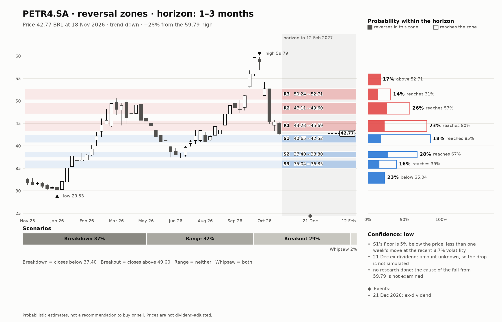

# stock_predict_zones

Turn price candles into **support and resistance zones with probabilities**, and plot the result.

The project is a three-step pipeline. Each step reads and writes plain JSON, so any step can be inspected, edited or replaced.

```
 Yahoo Finance            Claude + skill                     matplotlib
      │                        │                                 │
      ▼                        ▼                                 ▼
build_prompt.py  ──►  reversal-zones-projection  ──►  plot_projection.py
                input.json                 projection.json              chart.png / .svg / .pdf
```

| Step | Tool | Input | Output |
|---|---|---|---|
| 1. Collect | `build_prompt.py` | a ticker and a horizon | `input.json`: candles plus the request |
| 2. Project | `reversal-zones-projection` skill, run by Claude | `input.json` | `projection.json`: zones, probabilities, scenarios |
| 3. Plot | `plot_projection.py` | both JSON files | an image |



*Example output from the files in [`examples/`](examples/), using data as of 18 Nov 2026. It shows what the pipeline produces; it is not a forecast.*

> **Read this first.** The probabilities are internally consistent but have **not been backtested**. Nobody has yet checked whether a zone given a 20% chance of holding actually holds about 20% of the time. Treat the output as a structured way to look at a chart, not as a forecast you can rely on. Nothing here is investment advice.

## Contents

- [Setup](#setup)
- [Quick start](#quick-start)
- [Commands](#commands)
- [Step 1: build_prompt.py](#step-1-build_promptpy)
- [Step 2: the reversal-zones-projection skill](#step-2-the-reversal-zones-projection-skill)
- [Step 3: plot_projection.py](#step-3-plot_projectionpy)
- [Ranked trade setups](#ranked-trade-setups)
- [How the probabilities are produced](#how-the-probabilities-are-produced)
- [Glossary](#glossary)
- [Known limits](#known-limits)
- [Roadmap](#roadmap)
- [Project layout](#project-layout)

## Setup

Requirements: Python 3.12 or newer (see `.python-version`) and [uv](https://docs.astral.sh/uv/).

```bash
git clone https://github.com/pedrohml/stock_predict_zones.git
cd stock_predict_zones
uv sync
```

`uv sync` installs the four declared dependencies (`yfinance`, `matplotlib`, `numpy` and `pandas`) and the `zones` command, which is `run_pipeline.py`. Inside the repository run it as `uv run zones`.

To have `zones` in any directory, install it once from the repository folder:

```bash
uv tool install --editable .    # undo with: uv tool uninstall stock-predict-zones
```

The install must be editable. `zones` keeps running the scripts and the skill of this checkout, so edits and `git pull` take effect at once, and the folder must stay where it is. If the shell does not find `zones` afterwards, run `uv tool update-shell` and open a new terminal. Output folders and relative paths such as `--input` and `--out-dir` are taken from the directory you are in, not from the repository.

Tests: `uv run pytest` runs the offline suite in `tests/` (no network, a few seconds). It does not exercise the Yahoo Finance download.

Step 2 needs Claude with the skill in `.claude/skills/reversal-zones-projection/`. Claude Code picks it up automatically when run in this repository; other Claude apps need it installed. See [Installing the skill](#installing-the-skill).

## Quick start

One command, from ticker to chart and ranked trade setups (needs [Claude Code](https://claude.com/claude-code) installed and signed in):

```bash
uv run zones PETR4.SA --open          # plain `zones PETR4.SA --open` after the global install
```

It runs the three steps below in order, validates the projection with `rz.py check` before plotting, then computes three ranked trade setups (see [Ranked trade setups](#ranked-trade-setups)). It prints where the files are and, with `--open`, shows the chart in your default image viewer. `--horizon` and the other step-1 options work here too (the default horizon is `1-3m`). Step 2 takes about 2 to 6 minutes (longest with `--research deep`) and is the only Claude Code call; the trade-setups step is computed in under a second. Progress goes to standard error. Pass `--no-entries` to stop at the chart. `uv run python run_pipeline.py ...` is the same command.

Afterwards the same command lists, scores, redraws and recomputes what the runs left behind (`zones list`, `zones score`, `zones plot PETR4.SA`, ...): see [Commands](#commands).

Each run gets a new folder under the current directory:

```
runs/
└── PETR4.SA/
    ├── 2026-11-18T1515_1-3m/
    │   ├── input.json
    │   ├── projection.json
    │   ├── chart.png
    │   └── entries.json
    └── 2026-11-18T1515_1-3m_2/     the same input run a second time
```

The timestamp is the input's `now.time` (the last candle, in the exchange's local time), followed by the horizon, so folders sort by date. Nothing is overwritten: a name already taken gets `_2`, `_3`, ... A run that fails in step 2 leaves its folder with `input.json` only, ready for `--input`. `runs/` is in `.gitignore` and is only this command's output: delete any of it at any time. The record used for scoring later is the separate [`projections/`](#saved-projections) folder.

With `--out-dir DIR` the files go exactly into `DIR` instead, named after the ticker, lowercased and without the exchange suffix (`petr4_input.json`, `petr4_projection.json`, `petr4.png`, `petr4_entries.json`), and the next run of that ticker replaces them. `--out-dir .` is the behaviour of earlier versions.

While Claude works, each stage of the skill gets one line with the time elapsed, and the step ends with the duration, the number of turns and the cost:

```text
[2/5] Projection: Claude Code runs the skill (research: none). This can take several minutes; timeout 1800 s
      reading the skill's instructions                    0:02
      reading the input                                   0:04
      measuring the candles (rz.py levels)                0:08
      ... still running                                   0:39
      choosing zones                                      0:58
      simulating price paths (rz.py sim)                  1:02
      writing the projection                              2:30
      validating (rz.py check)                            2:33
      done in 2:39 · 9 turns · $0.80
```

A stage that happens again says so (`adjusting the zones`, `simulating again (rz.py sim, run 2)`). With web research each search shows its query and each page its host, never the content. `... still running` appears after 30 seconds without a new line. Turns and cost are the figures Claude Code reports for the run, and either is left out when it reports none. `--quiet` drops the stage lines and keeps the step headers, errors and the last line.

| Option | Default | Meaning |
|---|---|---|
| `TICKER` and any `build_prompt.py` option | | Passed to step 1 untouched (`--horizon`, `--research`, `--event`, `--language`, ...). See [Step 1](#step-1-build_promptpy). |
| `--out-dir DIR` | a new `runs/TICKER/TIME_HORIZON/` | Put the files exactly in `DIR`, as `STEM_input.json`, `STEM_projection.json`, `STEM.png` and `STEM_entries.json`. Files given with `--input` and `--projection` stay where they are. |
| `--name STEM` | none in a run folder, the ticker with `--out-dir` | File name stem. In a run folder it turns `input.json`, `projection.json`, `chart.png` into `STEM_input.json`, `STEM_projection.json`, `STEM.png`. |
| `--input FILE` | none | Use an existing input JSON and skip step 1 (no download). The run folder gets a copy. |
| `--projection FILE` | none | Use an existing projection JSON and skip step 2. Needs `--input`. The run folder gets a copy. |
| `--chart FILE` | `chart.png` in the run folder, `STEM.png` with `--out-dir` | Chart file. The extension picks the format. |
| `--open` | off | Open the chart in the default viewer when the run succeeds. A viewer that cannot be started is only a warning. |
| `--model NAME` | Claude Code's own | Model for the headless run. |
| `--timeout SECONDS` | `1800` | Give up on each Claude Code call after this long. |
| `--no-entries` | off | Stop at the chart: skip the trade-setups step. |
| `--entries-by-claude` | off | Have Claude write the sentences of the trade setups: a second Claude Code call of a few minutes. The numbers are the same. |
| `--quiet` | off | No line per stage during step 2. Headers, errors and the duration and cost line stay. |
| `--theme`, `--lang`, `--candles`, `--dpi` | step 3's own | Passed to `plot_projection.py` only when given. |
| `--no-save` | off | Do not keep the new projection under `projections/` (see [Saved projections](#saved-projections)). |

```bash
RUN=runs/PETR4.SA/2026-11-18T1515_1-3m
uv run zones --input $RUN/input.json                                         # project and plot again, no download
uv run zones --input $RUN/input.json --projection $RUN/projection.json       # plot again only
uv run zones --input $RUN/input.json --projection $RUN/projection.json --chart dark.svg --theme dark
```

The first two make a new, complete run folder each (`..._2`, then `..._3`), so the earlier chart stays. The third writes only `dark.svg`: plotting again into a named `--chart` creates no folder. To redraw the chart of a run in place, without a new folder, use `zones plot PETR4.SA` (see [Commands](#commands)).

Step 2 runs `claude -p` in this repository without bypassing permissions. Claude gets only the skill, the helper script and a throwaway work folder to write in (it can also read files of this repository), plus web search and page fetching when `--research` is not `none`; anything else is denied.

With research on (the default, `one_search`), Claude opens each page before citing it. That is the skill's own rule (see [What the skill does](#what-the-skill-does)) and the wrapper's prompt repeats it: a driver states only what its `source` page says, and a dividend amount or implied move read from an opened page goes into the simulation as a shock. Pages that refuse to load (some sites answer 403) are skipped, so the drivers come from the pages that did open.

The same thing by hand, one step at a time:

```bash
# 1. Candles and request for Petrobras, 1 to 3 month horizon
uv run python build_prompt.py PETR4.SA --horizon 1-3m -o petr4_input.json

# 2. Give petr4_input.json to Claude (paste or attach it).
#    The skill replies with the projection JSON. Save it as petr4_projection.json.

# 3. Chart
uv run python plot_projection.py petr4_input.json petr4_projection.json -o petr4.png
```

To try step 3 without Claude, use the ready-made pair in [`examples/`](examples/):

```bash
uv run python plot_projection.py examples/petr4_input.json examples/petr4_projection.json -o chart.png
```

## Commands

`zones` is one command for the run and for what comes after it. Inside the repository write `uv run zones ...`; after the global install, plain `zones ...` in any directory.

| Command | What it does | Runs |
|---|---|---|
| `zones TICKER [options]` | The pipeline of [Quick start](#quick-start). `zones run TICKER` is the same. | all steps |
| `zones list [TICKER]` | The [saved projections](#saved-projections), newest last, each `open` or `ended`. | `rz.py list` |
| `zones runs [TICKER]` | The run folders under `runs/` in the current directory, newest last, with the files each one holds. | nothing else |
| `zones score [TICKER \| FOLDER]` | Scores the saved projections against later prices. Downloads from Yahoo Finance. | `score_projections.py` |
| `zones plot WHAT [plot options]` | Draws the chart of a run again. | `plot_projection.py` |
| `zones show WHAT` | Prints the summary of a run. | `show_run.py` |
| `zones entries WHAT` | Computes the [trade setups](#ranked-trade-setups) of a run again and checks them. | `trade_entries.py build`, then `check` |

```bash
zones list                                   # every saved projection
zones score PETR4.SA --json                  # one ticker, as JSON
zones plot PETR4.SA                          # redraw the latest run's chart.png
zones plot nvda --theme dark --lang pt -o nvda_dark.png
zones plot PETR4.SA --horizon 1-2w --open    # the latest 1-2w run, then open the chart
zones entries runs/PETR4.SA/2026-11-18T1515_1-3m
zones plot --help                            # each command has its own help
```

**Command or ticker.** The first argument is a command only when it is exactly one of the lowercase words above. Anything else goes to the pipeline as before, so `zones nvda` still runs the pipeline for NVDA (step 1 upper-cases the ticker), and so do `zones --input FILE` and `zones --help`. For a ticker spelled like a command, write it in capitals (`zones LIST`) or put it after `run` or `--` (`zones run list`, `zones -- list`).

**WHAT** names one run, and comes first, before the options:

- A folder that holds `input.json` and `projection.json`: a run folder or a saved projection. A folder of `--out-dir` files (`petr4_input.json`, `petr4_projection.json`) works too; if it holds several pairs, pick one with `--name STEM`. A folder with run folders inside it, such as `runs/PETR4.SA`, means the latest of them.
- A ticker, in any letter case: its latest run under `runs/` in the current directory or, when there is none, its latest saved projection (`$RZ_PROJECTIONS_DIR`, else `./projections`). `--horizon H` narrows it to one horizon. "Latest" is read from the folder names (the time, then `_2`, `_3`, ...), and the folder chosen is printed.
- When nothing matches, the error names both places it looked. An existing folder wins over a ticker of the same name.

**Options are passed on.** Options a command does not declare go to the script it runs: `zones score --json`, `zones plot NVDA --theme dark --dpi 200 --no-check`, `zones show NVDA --lang pt`. The exit code is the script's. Relative paths are taken from the directory you are in.

**Where `plot` and `entries` write.** For a run folder they replace the folder's own `chart.png` or `entries.json`: `runs/` is working output and both files follow from the pair. For a saved projection they write `TICKER_FOLDER.png` or `TICKER_FOLDER_entries.json` (for example `PETR4.SA_2026-11-18T1515_1-3m.png`) in the current directory, because the saved history is append-only and nothing is added to it. `-o FILE` chooses the file in either case, and a file inside the saved history is refused. `entries` builds and checks the setups before replacing anything.

`zones list` and `zones runs` show two different things: `projections/` is the record kept for scoring, `runs/` is this command's output in the current directory.

## Step 1: build_prompt.py

Downloads candles from Yahoo Finance and writes one JSON holding the data and the request.

```bash
uv run python build_prompt.py TICKER [options]
```

`TICKER` is a Yahoo symbol, for example `NVDA`, `PETR4.SA` or `BTC-USD`. Without `-o` the JSON goes to standard output.

### Options

| Option | Default | Meaning |
|---|---|---|
| `--horizon` | `1-3m` | `today`, `1-2w`, `1-3m` or `6-12m`. Picks the candle sizes and what "probability" means (table below). |
| `--max-rows N` | preset | Cap the rows of the main series to shrink the file. `52` is enough for most uses. |
| `--volume` | off | Add a volume column to every row. |
| `--event 'DATE: TEXT'` | none | Add or refine an event, e.g. `--event "2026-11-17: Q3 earnings, after close"`. Repeatable. Replaces Yahoo's entry for the same date. |
| `--supports N` | `3` | How many support zones to ask for. |
| `--resistances N` | `3` | How many resistance zones to ask for. |
| `--research` | `one_search` | How much web research the skill may do: `none`, `one_search`, `deep`. |
| `--shape` | `table` | Shape of the prose that follows the projection: `table` or `list`. |
| `--max-words N` | `200` | Word limit for that prose. |
| `--language` | `en` | Language of the whole result: the free-text values in the projection and, in step 3, the chart's labels. The chart has labels for `pt` and `en`. |
| `--links` | `decisive_only` | Links in the prose: `none`, `decisive_only`, `all`. |
| `--decimals N` | `2` | Price rounding. |
| `-o FILE` | stdout | Write to a file. |

### Horizon presets

The horizon decides which series are embedded. The **main** series is what levels are read from. The **context** series is coarser and covers only the history *before* the main series starts, so the two never repeat each other.

| `--horizon` | Main series | Context series | Close basis | Probability |
|---|---|---|---|---|
| `today` | 15-minute, last 5 sessions (up to 140 rows) | daily, up to 40 rows | `15m` | `touched_once` |
| `1-2w` | daily, up to 90 rows | weekly, up to 52 rows | `1D` | `close_in_zone` |
| `1-3m` | weekly, up to 104 rows | monthly, up to 36 rows | `1W` | `close_in_zone` |
| `6-12m` | monthly, up to 120 rows | none | `1M` | `close_in_zone` |

### Output: the input JSON

Abridged example (real files have many more rows):

```json
{
  "task": "reversal_zones",
  "asset": { "ticker": "PETR4.SA", "venue": "São Paulo", "currency": "BRL" },
  "now": { "time": "2026-11-17T17:36-03:00", "price": 44.06, "session": "after_hours" },
  "horizon": "1-3m",
  "data": {
    "timezone": "America/Sao_Paulo",
    "split_adjusted": true,
    "columns": ["start", "open", "high", "low", "close"],
    "series": [
      { "candles": "1M", "last_row": "closed",
        "rows": [["2024-10-01", 36.01, 38.38, 35.34, 35.91],
                 ["2024-11-01", 36.2, 39.86, 35.03, 38.9]] },
      { "candles": "1W", "last_row": "forming",
        "rows": [["2026-11-09", 44.6, 45.69, 43.23, 45.3],
                 ["2026-11-16", 45.0, 45.39, 43.65, 44.06]] }
    ]
  },
  "events": [{ "date": "2026-12-21", "what": "ex-dividend" }],
  "want": { "supports": 3, "resistances": 3, "probability": "close_in_zone", "close_basis": "1W" },
  "research": "one_search",
  "reply": { "shape": "table", "max_words": 200, "language": "en", "links": "decisive_only" }
}
```

| Field | Notes |
|---|---|
| `now.session` | `open`, `closed`, `pre_market` or `after_hours`, from Yahoo's trading-period data. |
| `data.columns` | Shared by every series. Rows are compact arrays, oldest first, to keep the file small. |
| `series[].last_row` | `forming` when the newest candle is still being built, otherwise `closed`. A forming candle is not a signal yet. |
| `data.split_adjusted` | Prices are adjusted for splits but **not for dividends**, which matches what most charting platforms show. |
| `events` | Earnings and ex-dividend dates inside the horizon, from Yahoo's calendar, plus anything passed with `--event`. An empty list means none are known. |
| `want.probability` | `close_in_zone`: judged on candle closes. `touched_once`: judged on intra-candle extremes. |

## Step 2: the reversal-zones-projection skill

The skill lives in `.claude/skills/reversal-zones-projection/`. `SKILL.md` tells Claude how to turn an input JSON into a projection JSON, and `scripts/rz.py` is the helper that does the arithmetic.

### Installing the skill

In Claude Code there is nothing to install: the skill sits in `.claude/skills/`, so it is available whenever Claude Code runs in this repository.

For other Claude apps, add the `.claude/skills/reversal-zones-projection` folder (with its `scripts/` subfolder) as a custom skill. The copy in this repository is the source of truth; editing it does not change a skill that is already installed elsewhere.

### Using it

Paste or attach an input JSON. The skill triggers on `"task": "reversal_zones"` and replies with the projection in one `json` code block. Save that block as a file.

The skill also keeps every projection it makes, together with its input, under `projections/` (see [Saved projections](#saved-projections)).

### What the skill does

1. Runs its helper on the input to extract facts: trend, dominant swing, retracement levels, volatility, pivot highs and lows, gaps.
2. Chooses zones. Each zone needs at least two independent pieces of evidence taken from the rows, and every evidence string quotes exact prices so the zone can be audited.
3. Researches as far as `research` allows: the cause of the latest move and scheduled events inside the horizon. It opens every page it cites, so a driver states only what its `source` page says and an event's date and size are read from a page, never from a search summary or from memory. `one_search` is two searches (cause, events) plus those pages; `deep` adds follow-up searches and a second page for claims that rest on one. What it cannot confirm is left out and named in `confidence.limits`; where Claude has no web tools, the projection is made without research and says so.
4. Simulates future closes to get baseline probabilities (details [below](#how-the-probabilities-are-produced)).
5. Adjusts the baseline by a small, capped amount and records what it moved in `method`.
6. Validates the result (probabilities add up, zones do not overlap, scenarios sum to 1, every driver has a source) before replying.
7. Saves the input and the projection under `projections/`.

It does not give buy, sell or hold calls, stops, targets or position sizes.

### Output: the projection JSON

Abridged example:

```json
{
  "task": "reversal_zones",
  "asset": { "ticker": "PETR4.SA", "currency": "BRL" },
  "as_of": { "time": "2026-11-17T17:36-03:00", "price": 44.06 },
  "horizon": { "label": "1-3m", "close_basis": "1W", "closes": 13, "first": "2026-11-20", "last": "2027-02-12" },
  "structure": {
    "trend": "down",
    "swing": { "low": [28.86, "2025-06-09"], "high": [59.79, "2026-10-19"] },
    "retraced": 0.51,
    "from_high": -0.263,
    "volatility": { "per": "1W", "last_8": 0.085, "last_52": 0.05, "assumed": [0.063, 0.046] }
  },
  "supports": [
    { "id": "S1", "zone": [43.2, 44.6], "strength": "strong", "reach": 1.00, "turn": 0.20,
      "evidence": ["Nov 2026 weekly lows 43.23 and 43.65", "50% retracement 44.33"] },
    { "id": "below", "zone": [null, 37.4], "reach": 0.32, "turn": 0.32,
      "evidence": ["next reference 35.48, the 78.6% retracement"] }
  ],
  "resistances": [
    { "id": "R1", "zone": [45.3, 47.1], "strength": "moderate", "reach": 0.69, "turn": 0.18,
      "evidence": ["weekly closes of 45.30 on 2 and 9 Nov"] },
    { "id": "above", "zone": [52.7, null], "reach": 0.14, "turn": 0.14,
      "evidence": ["open gap 54.23-56.91"] }
  ],
  "scenarios": [
    { "name": "breakdown", "p": 0.50, "low": "below 40.6", "high": "49.6 or lower" },
    { "name": "breakout", "p": 0.25, "low": "40.6 or higher", "high": "above 49.6" },
    { "name": "range", "p": 0.19, "low": "40.6 or higher", "high": "49.6 or lower" },
    { "name": "whipsaw", "p": 0.06, "low": "below 40.6", "high": "above 49.6" }
  ],
  "events": [{ "date": "2026-12-21", "what": "ex-dividend", "effect": "price drops by the payout", "certainty": "medium" }],
  "drivers": [{ "what": "Brent fell from about US$118 to about US$98", "pull": "down", "source": "https://..." }],
  "confidence": { "level": "low", "limits": ["S1's floor is 2% below the price"] },
  "method": "200,000 simulated paths of 13 weekly closes ..."
}
```

| Field | Meaning |
|---|---|
| `zone` | `[from, to]`. `null` marks the open end of a tail entry (`below` or `above`). |
| `reach` | Chance the zone comes into play within the horizon. |
| `turn` | Chance the horizon's most extreme close is made in this zone: it is reached and does not break. This is the reversal probability. |
| `strength` | `strong`, `moderate` or `weak`, from how much independent evidence supports the zone. It is not a probability. |
| `scenarios` | Four outcomes that sum to 1, defined by whether the middle support and the middle resistance break. |
| `events[].certainty` | `high` when confirmed by the company or exchange, `medium` from a data feed, `low` when inferred from past years. |
| `confidence.level` | `low` or `medium`. Never `high`: chart levels have weak predictive power. |

On each side, `turn` values add up to the `reach` of the nearest zone, and each `reach` equals the sum of `turn` from that entry outward.

### Running the helper by hand

The helper, `.claude/skills/reversal-zones-projection/scripts/rz.py`, can be used without Claude:

```bash
RZ=.claude/skills/reversal-zones-projection/scripts/rz.py
uv run python $RZ levels input.json              # facts for choosing zones
uv run python $RZ sim input.json zones.json      # baseline probabilities
uv run python $RZ check projection.json          # validate a projection
uv run python $RZ save input.json projection.json   # keep the pair under projections/
uv run python $RZ list                           # the saved projections, oldest first
uv run python $RZ score input.json projection.json candles.json   # what the price did, from a file of later candles
```

`zones.json` lists the zones nearest first, plus optional scheduled shocks:

```json
{
  "supports": [[43.2, 44.6], [40.6, 42.2], [37.4, 38.6]],
  "resistances": [[45.3, 47.1], [47.1, 49.6], [50.2, 52.7]],
  "shocks": [{ "date": "2026-12-21", "drop": 1.19 }, { "date": "2026-11-17", "jump": 0.08 }]
}
```

### Saved projections

Every projection is kept by default, so that a batch of past projections can later be compared with what the price did. The skill runs `rz.py save` as its last step; you can run it yourself for a projection made elsewhere.

```
projections/
└── PETR4.SA/
    ├── 2026-11-18T1515_1-3m/
    │   ├── input.json          the candles and request the projection was made from
    │   └── projection.json     the projection, exactly as produced
    └── 2026-11-18T1515_1-3m_2/ the same input projected a second time
```

- The timestamp is the projection's `as_of.time`, in the exchange's local time, followed by the horizon.
- Nothing is overwritten. Projecting the same input again adds a `_2`, `_3`, ... folder.
- `save` refuses a projection that fails `check`, or whose ticker or time does not match the input.
- `zones list` (which runs `rz.py list`) prints one line per saved projection with its horizon's last date and whether that date has passed (`ended`) or not (`open`). Only `ended` projections can be scored in full.
- `run_pipeline.py` (`zones`) saves each projection it makes the same way, once it has passed `check`, and prints the folder. It does not save when `--projection` reuses an existing file or `--no-save` is given. Its own `runs/` folders use the same names but are a different thing: working output that can be deleted, while `projections/` is the record.
- The folder is `projections/` in the directory the command runs from. Set `RZ_PROJECTIONS_DIR`, or pass a folder as the last argument, to keep them elsewhere.
- `projections/` is in `.gitignore`: the history is local to your machine. Remove that line if you want to commit it.

### Scoring the saved projections

`score_projections.py` compares every saved projection with what the price did afterwards, then summarises how the forecast probabilities compared with the events.

```bash
uv run zones score                      # everything under projections/
uv run zones score PETR4.SA             # one ticker
uv run zones score projections/PETR4.SA/2026-11-18T1515_1-3m   # one saved folder
uv run zones score --json               # one JSON object instead of the tables
```

`zones score` runs the script with the same arguments; called directly it is `uv run python score_projections.py [FOLDER] [--ticker T] [--json]`, from the repository folder.

It downloads the later candles from Yahoo Finance once per ticker (split-adjusted, not dividend-adjusted, like step 1) and judges each projection with the simulation's own definitions (`outcome()` in `rz.py`, which shares its code with `sim`):

- **Measure.** Closes for `close_in_zone`, intra-candle lows and highs for `touched_once`.
- **Reached, broken, turned.** The nearest zone is reached when the lowest close (highest, for resistances) gets to its near edge, and always if the price started inside it. Every later entry, the tail included, is reached when the zone before it broke: strictly beyond its far edge. `turned` is true for the one entry per side where the horizon's extreme was made (reached and not broken), and for none if the nearest zone was never reached.
- **Scenario.** Exactly one of breakdown, breakout, range and whipsaw, from the far edges of the middle zones.
- **Which candles.** The input's last row if it was still forming (its close is the first close of the horizon), otherwise the candle after it, up to `horizon.last`. Weekly and monthly candles are built from daily ones. Intraday, the horizon is one session: the one in progress, or the next one if the market was shut.
- **Holidays.** Fewer candles than `horizon.closes` are scored as they are, with a note. An ended projection with less than half of its candles is not scored.
- **Open horizons.** The result is provisional and labelled `so far`. Only closed candles count for the close measure. A zone already reached or broken stays so; `turned` and the scenario can still change.
- **Not scored.** A stock split after the projection (its zone prices are on the old scale), realised prices that do not match the input's last closed candle, a failed download, or damaged saved files. Each is listed with its reason and the rest are still scored.

Only projections whose horizon has **ended** enter the calibration summary. Every `reach`, `turn` and scenario `p` is put in a 10-point bucket; per bucket the table shows the number of forecasts, their mean and how often the event happened. A `reach` of 1 for a zone the price started inside is left out, since it is true by definition. Each kind also gets a Brier score (mean squared difference between forecast and outcome, 0 is perfect) next to two reference forecasts: always 50% (25% for scenarios), and always the sample's own rate.

```
  reach: 8 forecasts, 38% happened
    Brier score 0.120 (0 is perfect); always saying 50% would score 0.250, always saying this sample's own rate 0.234
    forecast     n  mean forecast  observed
    10-20%       2           0.16      0.00
    30-40%       1           0.39      0.00
    ...
```

Read it with care. One projection contributes about twenty probabilities that are all judged on the same price path, and overlapping horizons of one ticker share most of that path, so the forecasts are far from independent. With a handful of projections the table is anecdote, not evidence. It describes calibration only: it is not a measure of returns and does not show that the method works or fails.

`rz.py score input.json projection.json candles.json` is the same judgement without the network: `candles.json` is a list of `[start, open, high, low, close]` rows of the close basis.

## Step 3: plot_projection.py

Draws the candles, the zones and the probabilities in one figure.

```bash
uv run python plot_projection.py INPUT.json PROJECTION.json [options]
```

Both files are needed: the projection does not contain candles. For a run made by `zones`, `zones plot PETR4.SA [options]` finds the two files and takes the same options (see [Commands](#commands)).

| Option | Default | Meaning |
|---|---|---|
| `-o FILE` | `projection.png` | Output image. The extension picks the format: `png`, `svg`, `pdf` or `jpg`. |
| `--theme` | `light` | `light` or `dark`. |
| `--lang` | from the input | Override for the language of the chart's own labels: `pt` or `en`. Without it the chart uses `reply.language` of the input, i.e. `--language` from step 1. |
| `--candles N` | automatic | How many past candles to show. The default is four times the horizon, with a minimum of 40. |
| `--dpi N` | `160` | Resolution for raster formats, from 1 to 1200. |
| `--no-check` | off | Plot a projection that fails the rules of `rz.py check`, printing them as warnings. |

### Validation

Both files are checked before anything is drawn. If something is wrong, the script prints every problem it found on stderr, one per line with the field's name, and exits with status 1 without writing an image:

```
Cannot plot, 2 problems:
  projection.as_of.price: missing, expected a number
  projection.supports[1].zone: expected [low, high] as two numbers, or one number and one null for a tail, got [42.2, "x"]
```

There are two levels:

- **Structure** (always blocks): unreadable or invalid JSON, swapped files, missing or mistyped fields, probabilities outside 0 to 1, unparseable dates, no zone with both edges, an output path that cannot be written. `structure`, `scenarios`, `events`, `drivers` and `confidence` may be left out; if present they must be well formed.
- **Rules** (block unless `--no-check`): the same rules as `rz.py check` (reach and turn add up, zones in order, scenarios sum to 1 and so on), plus `horizon.close_basis` naming a series the input has. A missing `scenarios` or `confidence` section is not counted here, so a draft can be plotted; `rz.py check` itself still demands them.

The rules are read from the skill's `rz.py`. If `plot_projection.py` is copied somewhere without it, only the structure is checked and a one-line note says so.

### Reading the chart

- **Main panel.** Candles for the series the projection was judged on. Rising candles are hollow and falling candles are filled, so colour is left for the zones. Supports are blue and resistances are red, faint over the history and stronger over the shaded horizon. A dashed line and a boxed number mark the current price. Diamonds on the time axis mark dated events.
- **Probability panel.** One bar per zone on the same price scale. The filled part is `turn` (reverses here) and the outline is `reach` (gets here).
- **Scenario bar.** The four scenarios as one segmented bar, with the rule for each written underneath.
- **Notes.** Drivers with their direction, events, the confidence level and its caveats. Long caveats and event names are cut with an ellipsis so that the block always fits.

The language is chosen once, with `--language` in step 1. It is stored in the input as `reply.language`; the projection's text (drivers, caveats, event names) is written in it and the chart's own labels, month names, date formats and number separators (`1,234.50` or `1.234,50`) follow it. Region variants are accepted (`pt-BR`, `en_US`). If the chart has no labels for the language (say `es`), or the input has no `reply` block, the labels are in English; in the first case a note on standard error says so.

`--lang` overrides the labels only: text that comes from the projection stays in the language it was written in.

## Ranked trade setups

The last step of `run_pipeline.py` writes three hypothetical trade setups, each with an entry, a stop and a target, ranked best first, to `entries.json` in the run folder. It runs by default; `--no-entries` skips it. The setups are derived from the projection only, so they inherit every limit of it.

By default the step makes no Claude Code call. Every price, payoff and probability follows from the projection by fixed rules, so `trade_entries.py build` computes them, and writes the sentences around them (`anchor`, `basis`, `why`, `watch`, the limits) from fixed wording in the language of `reply.language` (English or Portuguese; any other language gets English). It takes under a second and costs nothing.

With `--entries-by-claude`, Claude writes those sentences instead, for this projection in particular:

1. `trade_entries.py prompt` fills `prompts/trade_entries.md` with the input and the projection.
2. `claude -p` answers with one JSON object. This call gets no tools at all and runs outside the repository; in three real runs it took two to three minutes and reported a cost of $0.50 to $0.70.
3. `trade_entries.py check` validates the reply against `prompts/trade_entries.schema.json` and recomputes every price, payoff and probability from the projection. A reply that disagrees is kept for inspection, reported, and the run exits 1; the input, projection and chart are unaffected.

The numbers are identical either way: both paths are checked by the same `trade_entries.py check`.

When a new projection is saved under `projections/`, the setups are saved next to it as `entries.json`.

`zones entries PETR4.SA` computes and checks the setups of an existing run again (see [Commands](#commands)). The parts also run by hand, for example on the committed example:

```bash
uv run python trade_entries.py build  examples/petr4_input.json examples/petr4_projection.json -o entries.json
uv run python trade_entries.py prompt examples/petr4_input.json examples/petr4_projection.json > prompt.txt
uv run python trade_entries.py check  examples/petr4_input.json examples/petr4_projection.json reply.json
uv run python trade_entries.py expected examples/petr4_projection.json   # every valid setup, best first
```

How the setups are built:

- **Prices come from zone edges only.** A *reversal* enters at a zone's near edge and targets the first zone on the opposite side. A *continuation* enters where a zone breaks and targets the far edge of the next one. Stops sit a quarter of one candle's typical move beyond the zone.
- **Odds come from the projection.** `fill` and `win_if_filled` are computed from `reach` and `turn` by fixed formulas, and each entry's `basis` shows the numbers used.
- **Ranking** is by `edge.per_order`: the expected result in units of risk, counting orders that never fill as zero.

Read the limits before using the output:

- `win_if_filled` is a ceiling. The projection knows whether a zone held or broke by the end of the horizon, not whether the stop was touched before the target.
- The formulas are a heuristic layered on probabilities that are themselves not backtested. Continuation setups get no distance discount, so they tend to rank above reversals.
- There is no position size or leverage, and a setup marked `favourable` is not a recommendation.

## How the probabilities are produced

The helper simulates the future closes of the main series and counts how often each zone is reached or broken.

| Ingredient | Choice |
|---|---|
| Paths | 200,000, with a fixed random seed so identical inputs give identical baselines |
| Returns | Student-t with 5 degrees of freedom (fat tails), no drift |
| Volatility | Starts at the average of the last 13 and last 26 candles, decays linearly to the average of the last 52 and the whole series |
| Number of steps | 10 daily closes for `1-2w`, 13 weekly for `1-3m`, 12 monthly for `6-12m`, and the rest of the session for `today` |
| First step | Shortened when the newest candle is still forming |
| Scheduled shocks | `drop`: a cash dividend subtracted from the ex-date on. `jump`: an extra move on an event date, such as an options-implied earnings move |
| Measure | Closes for `close_in_zone`, intra-candle extremes for `touched_once` |

The simulation knows nothing about chart levels. The skill may therefore move a little probability, at most 0.10 in total on each side, typically from a tail into a zone with strong evidence. Every such move is written into `method`.

## Glossary

| Term | Meaning |
|---|---|
| Zone | A price band where several independent facts from the candles coincide. |
| Near edge, far edge | The side of a zone closest to the current price, and the side furthest from it. |
| Reached | Price gets to the zone's near edge. |
| Broken | Price goes beyond the zone's far edge. |
| Tail | The open-ended entry beyond the last zone on a side (`below`, `above`). |
| Hold | `turn / reach`: the chance a zone holds once it has been reached. |
| Middle zone | The second zone on a side, or the only one. Scenarios are defined on it. |
| Breakdown | The middle support breaks and the middle resistance does not. |
| Breakout | The middle resistance breaks and the middle support does not. |
| Range | Neither breaks. |
| Whipsaw | Both break within the horizon. |

## Known limits

- **Uncalibrated.** The probabilities have not been checked against a meaningful number of outcomes. `score_projections.py` can now compare saved projections with later prices, but the history is days old and no horizon has ended yet; no backtest on past dates has been run. This is the most important gap.
- **Scoring a touch on a forming candle.** For `touched_once`, a finished candle does not say whether its high or low came before or after the projection. For the candle that was forming, the scorer counts an extreme only if it is new, otherwise it uses the close, so a touch inside that candle's earlier range can be missed. Everything else is judged exactly as the simulation counts it.
- **Pre-market and first-of-month projections.** When the newest candle is closed but a new one has not started (a daily projection made before the open, a monthly one before the month's first session), `horizon.first` skips the candle about to begin. The scorer counts it anyway, since it comes after the projection, and notes that there are more closes than scheduled.
- **Yahoo Finance is unofficial.** Quotes can be delayed about 15 minutes on some exchanges and requests are sometimes rate-limited. One failed request currently ends the run.
- **Not dividend-adjusted.** For heavy dividend payers, old levels sit higher than a total-return chart would show.
- **Holidays.** A week ending on a holiday Friday is labelled `forming` until the weekend.
- **24-hour markets.** The session and week-end logic assumes a Monday-to-Friday exchange, so crypto tickers get wrong `forming` labels.
- **Zone choice is judgment.** Two runs on the same input can pick slightly different zone edges. The baseline probabilities for a given set of zones are reproducible.
- **`--shape json` is missing.** The skill accepts `"shape": "json"` (projection only, no prose), but `build_prompt.py` does not offer it yet. Edit the field by hand if needed.

## Roadmap

1. Backtest the baseline probabilities on past dates, to measure calibration on a sample large enough to mean something. Scoring of saved projections exists (`score_projections.py`); what is missing is the history. A useful addition is to score the unadjusted simulation next to the skill's adjusted numbers.
2. Add `json` to `--shape`.
3. Carry event sizes as numbers (dividend amount, implied move) so the skill does not have to search for them.
4. State `dividend_adjusted` explicitly in the input.
5. Retry on Yahoo failures and guard against duplicated or malformed rows.

## Project layout

```
stock_predict_zones/
├── build_prompt.py                 step 1: Yahoo Finance to input JSON
├── plot_projection.py              step 3: input + projection to image
├── run_pipeline.py                 the `zones` command: all steps in one (step 2 through headless Claude Code), and list, runs, score, plot, show, entries
├── score_projections.py            saved projections against later prices, and the calibration summary
├── trade_entries.py                trade setups: computes them, or fills the prompt and checks the reply
├── .claude/skills/reversal-zones-projection/
│   ├── SKILL.md                    step 2: the skill
│   └── scripts/rz.py               its helper: levels, simulation, validation, saving, outcomes
├── examples/                       one complete run: input, projection and charts
├── prompts/
│   ├── trade_entries.md            prompt: three ranked trade setups from one run
│   └── trade_entries.schema.json   JSON Schema of its reply
├── projections/                    every projection made, with its input (local, not committed)
├── runs/                           one folder per `zones` run: input, projection, chart (local, not committed)
├── pyproject.toml                  dependencies, Python version and the `zones` command
├── uv.lock
└── README.md
```

## Disclaimer

This project produces probabilistic estimates for study and discussion. It is not investment advice and not a recommendation to buy or sell any security.
